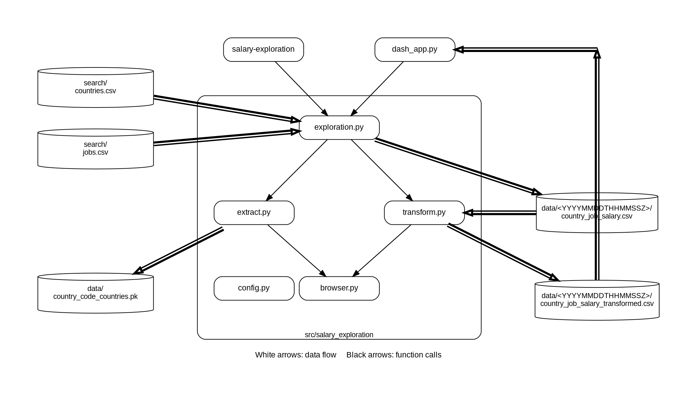
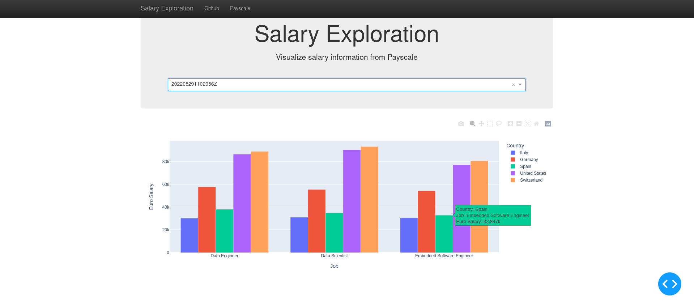

# Salary exploration

     

**Big refactor needed. Code is pretty messy. I'll do it as soon as I have some free time.**

## Introduction
 
The idea is to automatically search on [payscale.com](https://www.payscale.com/) the salary for a list of jobs in different countries and visualize the results with a Dash web application.

## Software and libraries

This project uses Python 3.15 and the most important packages are:

- [Pandas](http://pandas.pydata.org)
- [Selenium](https://pypi.org/project/selenium/)
- [dash](https://dash.plotly.com/)

Set up the project with `uv sync` from the project folder. Then run checks with `uv run pre-commit run --all-files` or `uv run pytest`.

## Data

Have a look at the `data` folder and its [DATA.md](data/DATA.md) file.

## Local configuration

To setup a new local enviroment and install all dependencies you can run `.\my_scripts\Set-Up.ps1`. It will install:

* [Python](https://www.python.org/)
* [uv](https://docs.astral.sh/uv/)
* [Pre-commit](https://pre-commit.com/)

## Code Quality

Code quality is maintained through automated checks and linting using pre-commit.

Pre-commit is a framework for managing and maintaining multi-language pre-commit hooks. A pre-commit hook is a script that runs before a commit operation in a version control system. This allows to shift left code quality checks and remediations. You can change the hooks by updateing the file `.pre-commit-config.yaml`.

To trigger the pre-commit hooks without an actual commit you can run `pre-commit run --all-files -v`.

It is also possible to run manully the individual tools:

- `uv run ruff check --fix`
- `uv run ruff format .`
- `uv run pyright .`

## Testing

Tests are implemented using `pytest` and coverage is tracked with `pytest-cov`. The detailed coverage report is genarated by the pre-commit hook and it is available in [COVERAGE.md](COVERAGE.md) file.

It is also possible to run manully the individual tests:

- `uv run pytest`
- `uv run pytest tests/test_dummy.py::test_dummy`

## Running the code

### Console

You can run `uv run python salary_exploration.py`.

### Web app

You can run `uv run python dash_salary_exploration.py` to start the dash application. The default url to connect to it is http://127.0.0.1:8050/.

<pre>
|-- salary_exploration: project folder
    |-- dash_app.py: web application module for visualize the data
    |-- salary_exploration.py: module for search organizazion
    |-- transform_data.py: module for data transformation
    |-- extract_data.py: module for data extraction
    |-- search: folder for the searching files
    |   |
    |   |-- countries.csv: list of countries to search
    |   |-- jobs.csv: list of jobs to search
    |
    |-- data: folder for the data
    |   |
    |   |-- YYYYMMDDTHHMMSSZ: folder for historicization of every search
    |   |
    |   |-- country_code_countries.pkl: file with the country code and country mapping
    |
    |-- README.md
    |-- TODO.md
</pre>

All the modules provide the help funcionality provided by [argparse](https://docs.python.org/3/library/argparse.html) module.

Every run is identified by the YYYYMMDDTHHMMSSZ date string.

First you need to place in the `searh` directory the files:
* countries.csv: list of the country to search
* jobs.csv: list of the jobs to search

I no file is provided the a deafult list will be used as demo porpuse.

The job will ten create the file `country_job_salary.csv` by scraping the [payscale.com](https://www.payscale.com/) web site.

Finally the data wil be transformed to convert the salary from local currency to a common one and saved in the file `country_job_salary_transformed.csv`

Flowchart made using [draw.io](https://about.draw.io/)

The white arrow indicates a flow of data while the black one indicates a call of functionalities.

## Results

The dash application 

Using the dropdown menu is possible to select the extraction to visualize.

## List of activities

In the [TODO.md](TODO.md) file you can find the list of tasks and ongoing activities.

## Licensing and acknowledgements

Have a look at [LICENSE.md](LICENSE.md) and many thanks [payscale.com](https://www.payscale.com/) for the data. Payscale offer a wide variety of products and services in the compensation technology.

## Outro

I hope this repository was interesting and thank you for taking the time to check it out. On my Medium you can find a more in depth [story](https://medium.com/@simone-rigoni01/salary-exploration-with-python-and-payscale-data-786e5557bcbc). Let me know if you have any question and if you like the content that I create feel free to [buy me a coffee](https://www.buymeacoffee.com/simonerigoni).
